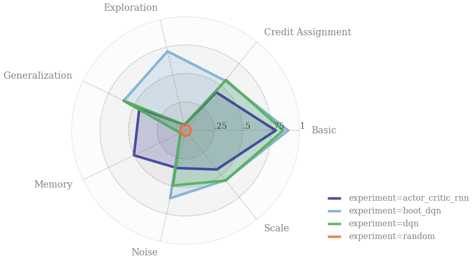

# 强化学习行为基准套件 (`bsuite`)


<p align="center">
  <a href="README.md">English</a> · <b>简体中文</b>
</p>



## 简介 (Introduction)

`bsuite` 是一套精心设计的强化学习（RL）实验集合，致力于深入探究强化学习智能体的核心能力，包含两大核心目标：

1. 收集清晰明确、信息量丰富且具扩展性的典型问题，以精准刻画通用高效学习算法设计中的关键挑战。
2. 通过智能体在这些标准化共享基准上的表现，系统性研究其行为特性与泛化能力。

本库自动化了任何智能体在这些基准上的评测与分析全流程。旨在促进强化学习核心问题上可复现、低门槛的研究，并最终推动设计出性能更优越的强化学习算法。

展望未来，我们期待吸纳更多来自学术界与开源社区的优秀实验设计，并由杰出研究人员组成的评审委员会定期对各项实验进行审阅与维护。

更全面的技术总览请参阅配套学术[论文][paper]。

## 技术架构概览 (Technical overview)

`bsuite` 是一组在 [`experiments`] 子目录中定义的*实验集合*。每个子目录对应一个独立实验，通常包含：

- 一个定义 RL 环境的文件，支持通过不同参数配置难度等级或随机种子（例如）。
- 该环境的一组关键字参数序列，定义在各实验 `sweep.py` 文件的 `SETTINGS` 变量中。
- 一个 `analysis.py` 文件，用于定义在配套 Jupyter Notebook 中呈现的分析图表。

`bsuite` 通过在每个环境中内置日志记录机制工作，当通过 [`load_and_record*` 函数](#加载内置日志记录的环境) 加载环境时即可自动记录数据。这意味着任何实验都将自动输出标准格式的评测数据以供 Notebook 分析，且完全不对智能体或算法的设计结构施加任何侵入式约束。

我们整理了预制的 Jupyter Notebook 交互分析环境：[bit.ly/bsuite-colab](https://bit.ly/bsuite-colab)。

## 快速上手 (Getting started)

如果您是 `bsuite` 的新用户，可以从我们的 [Colab 交互教程](https://colab.research.google.com/drive/1rU20zJ281sZuMD1DHbsODFr1DbASL0RH) 开始体验。该 Jupyter Notebook 运行在免费的云端服务器上，无需在本地安装任何内容即可立即开始编码。体验之后，您可以按照以下指引在本地计算机上安装并运行 `bsuite`。

### 环境安装 (Installation)

我们已在 Python 3.6 与 3.7 环境下对 `bsuite` 进行了全面测试。安装依赖步骤如下：

1. **可选（推荐）**：建议使用 [Python 虚拟环境](https://docs.python.org/3/tutorial/venv.html) 管理依赖，以避免影响系统的全局 Python 环境：

    ```bash
    python3 -m venv bsuite
    source bsuite/bin/activate
    pip install --upgrade pip setuptools
    ```

2. 直接从 [PyPI](https://pypi.org/project/bsuite) 安装 `bsuite`：

    ```bash
    pip install bsuite
    ```

3. **可选**：如需安装运行 [`baselines`] 基线示例（不包含 OpenAI 与 Dopamine 示例）的附加依赖，请运行：

    ```bash
    pip install bsuite[baselines]
    ```

## 评测环境 (Environments)

各个环境及其对应实验的完整说明详见 [`analysis/results.ipynb`] Jupyter Notebook。

这些环境都具有较小的观测空间维度，允许使用小型神经网络在 CPU 上即可获得出色的运行效率。

### 加载环境 (Loading an environment)

各个环境通过一个 `bsuite_id` 字符串唯一指定，例如 `"deep_sea/7"`。该字符串表示实验名称以及要使用的环境配置（索引），如[技术架构概览](#技术架构概览-technical-overview)中所述。

各环境及其对应实验设置的完整说明请参阅配套[论文][paper]。

```python
import bsuite

env = bsuite.load_from_id('catch/0')
```

可以通过以下代码以编程方式获取运行全部实验所需的 `bsuite_id` 序列：

```python
from bsuite import sweep

sweep.SWEEP
```

该模块还通过与实验名称对应的大写常量，提供了单独访问每个实验的 `bsuite_id` 列表，例如：

```python
sweep.DEEP_SEA
sweep.DISCOUNTING_CHAIN
```

此外，还可以通过以下方式加载具有相同标签的 `bsuite_id` 序列：

```python
from bsuite import sweep

sweep.TAGS
```

`TAGS` 字典根据底层标签将 `bsuite` 环境分组，因此可以通过以下方式加载所有 `basic` 或 `scale` 任务：

```python
sweep.TAGS['basic']
sweep.TAGS['scale']
```

### 加载内置日志记录的环境 (Loading an environment with logging included)

我们提供了一个开箱即用的自动日志记录实现，可通过以下方式调用：

[`bsuite.load_and_record_to_csv`]。它会为每个 `bsuite_id` 输出一个 CSV 文件，非常适合将一组 bsuite 实验分布在多台机器上并行运行。具体实现在 [`logging/csv_logging.py`]。

注：早期版本的 bsuite 包含 SQLite 日志记录器。如果您需要使用该功能，请随时联系我们，我们可以重新启用并恢复支持。

我们还在 [`logging/terminal_logging.py`] 中提供了一个终端日志记录器，可通过 `bsuite.load_and_record_to_terminal` 进行调用。

如果您需要将结果保存到不同的存储系统，编写自定义日志记录机制非常简单，可直接参考 CSV 实现作为参考范例。

### 与环境交互 (Interacting with an environment)

我们的所有环境均实现了 [`dm_env`](https://github.com/deepmind/dm_env) 中定义的标准 Python 接口。

具体而言，所有环境都接受一个从 0 开始的离散整数动作（或形状为 `()` 的标量 numpy 数组）。

要获取特定环境的离散动作总数，请使用：

```python
num_actions = env.action_spec().num_values
```

每个环境均以 numpy 数组的形式返回观测值。

我们还为 bsuite 中的每个环境公开了 `bsuite_num_episodes` 属性。这允许用户精确运行 bsuite 分析所需的训练回合（Episode）数（不同实验所用环境的所需回合数可能有所不同）。

一个包含 `step()` 方法的典型智能体运行循环示例如下：

```python
for _ in range(env.bsuite_num_episodes):
  timestep = env.reset()
  while not timestep.last():
    action = agent.step(timestep)
    timestep = env.step(action)
  agent.step(timestep)
```

### 以 OpenAI Gym 格式使用 bsuite (Using `bsuite` in 'OpenAI Gym' format)

若要在基于 [OpenAI Gym](https://github.com/openai/gym) 接口的代码库中使用 `bsuite`，可以使用 [`utils/gym_wrapper.py`] 中的 `GymFromDMEnv` 包装类：

```python
import bsuite
from bsuite.utils import gym_wrapper

env = bsuite.load_and_record_to_csv('catch/0', results_dir='/path/to/results')
gym_env = gym_wrapper.GymFromDMEnv(env)
```

请注意，`bsuite` 默认依赖项中不包含 Gym，因此您可能需要单独 pip 安装它。

## 基线智能体 (Baseline agents)

我们在 [`baselines/`] 子目录中提供了几种常见智能体的参考实现，并附带了最小运行循环代码。

有关如何在安装时包含必要依赖，请参阅[环境安装](#环境安装-installation)一节。`bsuite` 默认不安装这些依赖，因为它不强制要求用户使用任何特定的机器学习框架。

## 运行完整基准测试套件 (Running the entire suite of experiments)

`baselines` 目录中的每个智能体都包含一个 `run` 脚本作为运行范例。通过传入 `--bsuite_id=SWEEP` 标志，可以针对单个环境运行，也可以针对完整的基准实验套件运行；这将启动一个进程池，以宿主机硬件允许的最大并行度并发运行实验。在 12 核机器上，大多数智能体可以在一晚内完成全套测试。或者，也可以使用 `run_on_gcp.sh` 在 Google Cloud Platform 上分布式运行，具体步骤如下。

### 在 Google Cloud Platform 上运行实验 (Running experiments on Google Cloud Platform)

[`run_on_gcp.sh`](run_on_gcp.sh) 脚本按顺序自动执行以下操作：

1. 创建指定规格的云实例（默认配置为 64 核 CPU 优化型实例）。
2. `git clone` 检出 `bsuite` 仓库并自动安装其他依赖。
3. 在指定环境下运行指定的智能体（目前限制在 `/baselines` 范围内）。
4. 将生成的 SQLite 文件从远程实例拷贝至本地主机的 `/tmp/bsuite.db`。
5. 自动关机并销毁创建的云端实例。

要运行该脚本，您首先需要创建一个计费账户，然后按照 [官方指南](https://cloud.google.com/sdk/docs/quickstart-debian-ubuntu) 安装并初始化 Cloud SDK。完成 `gcloud init` 配置后，即可在 Google Cloud 上运行 `bsuite`。

为此，为 [`run_on_gcp.sh`](run_on_gcp.sh) 添加可执行权限并运行：

```bash
chmod +x run_on_gcp.sh
./run_on_gcp.sh
```

实例创建完成后将打印实例名称。随后您可以通过在 Google Cloud 控制台中选择 `Compute Engine -> Instances` 并点击 `SSH` 登录实例。注意这一步并非必须，因为测试完成后结果会自动拷贝到本地。但如果您希望对智能体或环境进行临时本地调试，通过 SSH 登录会非常方便。在这种情况下，登录后执行：

```bash
~/bsuite_env/bin/activate
```

以激活虚拟环境，然后即可直接启动智能体运行脚本，例如：

```bash
python ~/bsuite/bsuite/baselines/dqn/run.py --bsuite_id=SWEEP
```

### 实验分析 (Analysis)

`bsuite` 在 [`analysis/results.ipynb`] 中提供了一个开箱即用的 Jupyter 分析 Notebook。该 Notebook 可直接加载并处理记录的实验数据，并为每个实验生成雷达图与各项能力得分。我们建议将该 Notebook 与 [Google Colaboratory](https://colab.research.google.com) 配合使用。

我们在此提供了一份完整的 `bsuite` 评估报告示例：[Colab 示例报告](https://colab.research.google.com/drive/1RYWJaMEHVeN8yI83QtL35GOSFQBRgLaX)。

### bsuite 评测报告 (`bsuite` Report)

您可以使用 `bsuite` 自动生成标准的 1 页纸附录（Appendix），系统性总结您的强化学习算法的核心能力。该附录格式与各大主流机器学习顶级学术会议（如 NeurIPS、ICLR、ICML）格式完全兼容。生成示例命令如下：

```bash
pdflatex bsuite/reports/neurips_2019/neurips_2019.tex
```

更多 bsuite 报告模板与范例可在 `reports/` 子目录中查看。

## 引用 (Citing)

如果您的研究或学术论文使用了 `bsuite`，请引用配套学术[论文][paper]：

```bibtex
@inproceedings{osband2020bsuite,
    title={Behaviour Suite for Reinforcement Learning},
    author={Osband, Ian and
            Doron, Yotam and
            Hessel, Matteo and
            Aslanides, John and
            Sezener, Eren and
            Saraiva, Andre and
            McKinney, Katrina and
            Lattimore, Tor and
            {Sz}epesv{\'a}ri, Csaba and
            Singh, Satinder and
            Van Roy, Benjamin and
            Sutton, Richard and
            Silver, David and
            van Hasselt, Hado},
    booktitle={International Conference on Learning Representations},
    year={2020},
    url={https://openreview.net/forum?id=rygf-kSYwH}
}
```

[`analysis/results.ipynb`]: bsuite/analysis/results.ipynb
[`baselines`]: bsuite/baselines/
[`bsuite.load_and_record_to_csv`]: bsuite/bsuite.py
[`bsuite.load_and_record_to_sqlite`]: bsuite/bsuite.py
[`experiments`]: bsuite/experiments/
[`logging/csv_logging.py`]: bsuite/logging/csv_logging.py
[`logging/sqlite_logging.py`]: bsuite/logging/sqlite_logging.py
[`logging/terminal_logging.py`]: bsuite/logging/terminal_logging.py
[`utils/gym_wrapper.py`]: bsuite/utils/gym_wrapper.py

[paper]: https://openreview.net/forum?id=rygf-kSYwH

---

> **翻译说明（Translation Disclaimer）**
> 本文档由社区志愿者（[@JasonYeYuhe](https://github.com/JasonYeYuhe)）人工翻译并维护，旨在降低中文开发者的阅读门槛。最后同步日期：2026年10月18日。若译文与英文原版存在任何出入或滞后，请以 [英文原版 (README.md)](README.md) 为准。欢迎通过 PR 协助改进译文！
